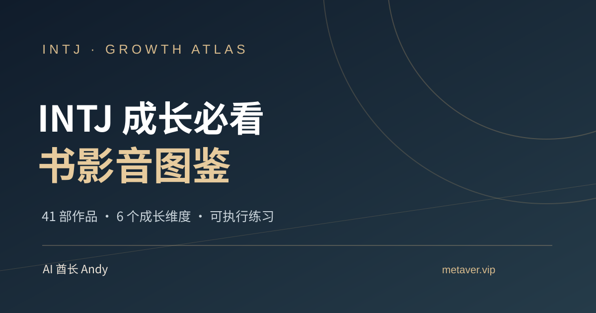

# INTJ 成长必看书影音图鉴

> 41 部电影、电视剧、书籍与纪录片，六个成长维度。看完就能练，读完就能用。

**作者 AI 酋长 Andy** · [个人网站](https://metaver.vip/) · [职业咨询与 AI 成长陪跑](https://metaver.vip/services) · 微信 `AIPMAndy`



**[从这里开始｜10 分钟找到第一部作品](START-HERE.md)**

## 🌐 在线阅读

**[互动网站](https://aipmandy.github.io/intj-growth-guide/)** · [41 部作品完整攻略](article.html) · [7 天 / 30 天互动计划](plan.html) · [全部结构化数据](data/catalog.json)

> GitHub Pages 需先在 Settings → Pages 设置 Deploy from a branch / main / root。未显示部署成功前请先通过仓库中的 HTML 预览。

## 书影音清单

| 分类 | 数量 | 代表作品 |
| --- | ---: | --- |
| 美剧与电视剧 | 10 | 《后翼弃兵》《硅谷》《风骚律师》《继承之战》《熊家餐馆》 |
| 电影 | 12 | 《十二怒汉》《点球成金》《心灵捕手》《火星救援》《爆裂鼓手》 |
| 书籍 | 15 | 《系统之美》《深度工作》《非暴力沟通》《侦察兵思维》《四千周》 |
| 纪录片 | 4 | 《AlphaGo》《寿司之神》《最后之舞》《抽象：设计的艺术》 |
| **总计** | **41** | 六条成长路线 |

六条路线：**决策判断、系统思维、职业与商业、沟通与关系、情绪与自洽、执行与成长**。

## 保姆级使用方式

1. 打开 [互动网站](index.html)，先选择最需要改善的成长维度，再按照问题筛选作品。
2. 点击作品详情，先读**为什么看、核心收获、看完怎么用、别学偏了**四个部分。
3. 用 [一页笔记模板](templates/notes-template.md) 把收获转化为现实行动。
4. 跟着 [7 天路线](guides/7-day-starter.md) 或 [30 天成长路线](guides/30-day-growth-plan.md) 实践。
5. 用 [每周复盘模板](templates/weekly-review.md) 记录客观证据，再决定是否调整。

## 网站功能

- 中文片名、英文作品名及关键词即时搜索
- 4 种媒介、6 类成长维度与阅读难度筛选
- 收藏、标记完成、本地进度条与随机推荐
- 41 篇作品解读汇成可离线打开的完整攻略页
- 独立的 7 天 / 30 天可勾选实践页，行动记录可导出
- 无第三方 CDN、无账号、无需后端；移动端适配
- 个人网站 / 服务页 / 微信 AIPMAndy 入口

**隐私：** 阅读进度只保存在当前浏览器 localStorage，清理缓存、换设备或私密浏览可能丢失。网站不采集用户账号和私密数据。

## 项目结构

```text
├── index.html               # 单文件交互首页
├── article.html             # 41 部作品深度解读
├── plan.html                # 7/30 天可勾选成长计划
├── data/catalog.json        # 41 条完整结构化条目
├── site/                    # 可维护的网站样式、模板与脚本
├── guides/                  # 新手路线、系统成长及阅读方法
├── templates/               # 书影音笔记、每周复盘
├── docs/                    # 方法、来源、上线手册与审核
├── assets/                  # 原创视觉封面
├── scripts/build.py         # 重新生成独立首页
├── tests/test_content.py    # 内容与构建基础检验
├── .github/workflows/check.yml
├── LICENSE
└── CONTRIBUTING.md
```

## 本地运行与修改

安装 Python 3.9+ 即可，无须安装依赖。

```bash
python3 scripts/build.py
python3 -m unittest discover -s tests -v
python3 -m http.server 8000
```

访问 http://localhost:8000/ 。修改 `data/catalog.json` 和 `site/` 内容后重新构建 `index.html`。详细见 [发布手册](docs/PUBLISH.md)。

## 关于人格类型与版权

INTJ 在这里是一个组织阅读主题的标签。MBTI 类型不能可靠地预测个人能力、工作表现或人生走向，不建议将作品人物直接判定为 INTJ。所有解读和实践练习属于编辑性建议，不构成医学或心理治疗方案。

本仓库不提供盗版影视、电子书下载；片名、书名、原作者用于作品识别，作品相关权利归权利人所有。仓库原创代码、编辑内容和原创插画采用 [MIT License](LICENSE)，保留署名及版权声明。

欢迎提交 Issue 与 Pull Request 补充作品，详见 [CONTRIBUTING.md](CONTRIBUTING.md)。欢迎 Star ⭐、Fork 与分享！

**AI 酋长 Andy** · [metaver.vip](https://metaver.vip/) · 微信 `AIPMAndy`
