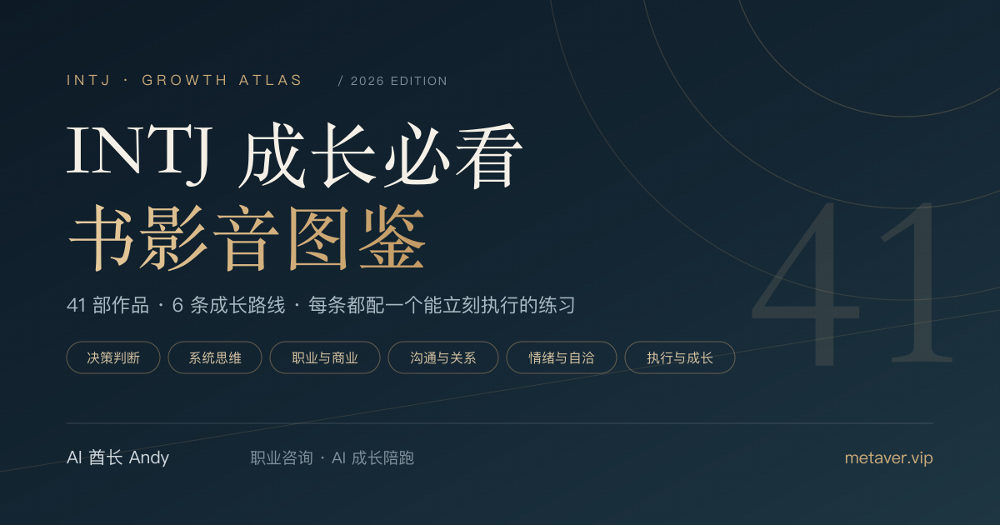

# INTJ 成长必看书影音图鉴

> 41 部电影、电视剧、书籍与纪录片，六条成长路线。看完就能练，读完就能用。

**INTJ 适合看哪些书、电影和纪录片？** 这份由 AI 酋长 Andy 整理的免费开源图鉴收录 41 部电影、电视剧、书籍与纪录片，分六条成长路线，每部都配一个看完就能做的练习。


[](https://github.com/AIPMAndy/intj-growth-guide/actions/workflows/deploy-pages.yml)
[](https://github.com/AIPMAndy/intj-growth-guide/actions/workflows/check.yml)
[](LICENSE)
[](#技术选择)

**作者 AI 酋长 Andy** · [个人网站](https://metaver.vip/) · [职业咨询与 AI 成长陪跑](https://metaver.vip/services) · 微信 `AIPMAndy`



**[从这里开始｜10 分钟找到第一部作品](START-HERE.md)** · **[在线阅读](https://aipmandy.github.io/intj-growth-guide/)**

## 目录

- [在线阅读](#在线阅读)
- [清单概览](#清单概览)
- [怎么用](#怎么用)
- [配套资源](#配套资源)
- [项目结构](#项目结构)
- [本地开发](#本地开发)
- [技术选择](#技术选择)
- [参与共建](#参与共建)
- [人格类型与版权](#人格类型与版权)

## 在线阅读

| 页面 | 内容 | 地址 |
| --- | --- | --- |
| 互动首页 | 搜索、四类媒介与六个维度筛选、收藏与进度 | [aipmandy.github.io/intj-growth-guide](https://aipmandy.github.io/intj-growth-guide/) |
| 完整攻略 | 41 篇解读：为什么看、核心收获、看完怎么用、别学偏了 | [article.html](https://aipmandy.github.io/intj-growth-guide/article.html) |
| 成长计划 | 7 天起步与 30 天训练，任务可勾选、记录可导出 | [plan.html](https://aipmandy.github.io/intj-growth-guide/plan.html) |
| 结构化数据 | 41 条完整条目，可直接复用或二次开发 | [data/catalog.json](data/catalog.json) |

网站通过 [GitHub Actions](.github/workflows/deploy-pages.yml) 自动部署：每次推送到 `main` 先跑构建一致性检查与测试，通过后才发布。若页面异常，请先看 [部署记录](https://github.com/AIPMAndy/intj-growth-guide/actions/workflows/deploy-pages.yml)。

## 清单概览

| 分类 | 数量 | 代表作品 |
| --- | ---: | --- |
| 美剧与电视剧 | 10 | 《后翼弃兵》《硅谷》《风骚律师》《继承之战》《熊家餐馆》 |
| 电影 | 12 | 《十二怒汉》《点球成金》《心灵捕手》《火星救援》《爆裂鼓手》 |
| 书籍 | 15 | 《系统之美》《深度工作》《非暴力沟通》《侦察兵思维》《四千周》 |
| 纪录片 | 4 | 《AlphaGo》《寿司之神》《最后之舞》《抽象：设计的艺术》 |
| **总计** | **41** | 六条成长路线 |

六条路线：**决策判断、系统思维、职业与商业、沟通与关系、情绪与自洽、执行与成长**。

## 怎么用

1. 打开[互动网站](https://aipmandy.github.io/intj-growth-guide/)，先选择最需要改善的成长维度，再按具体问题筛选作品。
2. 点开作品详情，先读**为什么看、核心收获、看完怎么用、别学偏了**四个部分。
3. 用[一页笔记模板](templates/notes-template.md)把收获转成现实行动。
4. 跟着[7 天路线](guides/7-day-starter.md)或[30 天成长路线](guides/30-day-growth-plan.md)实践。
5. 用[每周复盘模板](templates/weekly-review.md)记录客观证据，再决定是否调整。

原则只有一条：**先选问题，再选作品；每次只练一个动作。**

## 配套资源

| 资源 | 用途 |
| --- | --- |
| [START-HERE.md](START-HERE.md) | 10 分钟起步：一个问题、一部作品、一个动作 |
| [guides/7-day-starter.md](guides/7-day-starter.md) | 7 天轻量起步路线 |
| [guides/30-day-growth-plan.md](guides/30-day-growth-plan.md) | 30 天四周训练路径 |
| [guides/reading-method.md](guides/reading-method.md) | 15 分钟行动卡：看完只回答四个问题 |
| [templates/notes-template.md](templates/notes-template.md) | 一页作品行动笔记 |
| [templates/weekly-review.md](templates/weekly-review.md) | 每周复盘：证据、反方视角、下一步 |
| [plan.html](https://aipmandy.github.io/intj-growth-guide/plan.html) | 可勾选计划页，进度存本机，可导出 Markdown |
| [docs/SELECTION.md](docs/SELECTION.md) | 收录标准：为什么不按榜单排序 |
| [docs/SOURCES.md](docs/SOURCES.md) | 来源、内容边界与维护规则 |
| [docs/ADVERSARIAL_REVIEW.md](docs/ADVERSARIAL_REVIEW.md) | 反方审核：人格决定论、把剧本当管理学等风险 |
| [docs/PUBLISH.md](docs/PUBLISH.md) | 发布与回滚手册 |

## 项目结构

```text
├── index.html                  # 由 site/ 生成的单文件交互首页
├── article.html                # 41 部作品深度解读（手工维护）
├── plan.html                   # 7/30 天可勾选计划（手工维护）
├── 404.html                    # GitHub Pages 自定义 404
├── data/catalog.json           # 41 条结构化条目（内容真源）
├── site/                       # 首页的样式、模板与脚本
├── guides/                     # 起步路线、30 天计划与阅读方法
├── templates/                  # 作品笔记与每周复盘模板
├── docs/                       # 收录标准、来源、上线手册与反方审核
├── assets/                     # 社交预览图（SVG + PNG）与站点图标
├── scripts/
│   ├── build.py                # 生成 index.html，--check 供 CI 校验
│   └── check.py                # 一键跑完本地全部检查
├── tests/
│   ├── test_content.py         # 条目字段、分布、文本质量与构建一致性
│   └── test_site.py            # 元信息、图标、内链锚点、sitemap 与配套文件
├── sitemap.xml · robots.txt
├── .github/
│   ├── workflows/check.yml     # 推送与 PR 校验
│   ├── workflows/deploy-pages.yml
│   ├── ISSUE_TEMPLATE/         # 作品推荐与内容纠错表单
│   └── PULL_REQUEST_TEMPLATE.md
├── LICENSE
└── CONTRIBUTING.md
```

## 本地开发

只需 Python 3.9+，没有第三方依赖。

```bash
python3 scripts/build.py     # 修改 data/ 或 site/ 后重新生成 index.html
python3 scripts/check.py     # 构建一致性 + 全部测试
python3 -m http.server 8000  # 本地预览 http://localhost:8000/
```

改内容时只需动 `data/catalog.json`；改样式或交互时动 `site/`，然后重新构建。**不要手改 `index.html`**，它会被下次构建覆盖。详细流程见[发布手册](docs/PUBLISH.md)。

## 技术选择

- 纯静态：无框架、无构建服务、无第三方 CDN，克隆即可打开。
- 隐私优先：阅读进度与计划勾选只存在浏览器 localStorage，不采集账号与行为。
- 内容与展示分离：条目在 JSON 里，页面由脚本生成，改内容不必碰 HTML。
- 有测试的静态站：条目字段、元信息、图标尺寸、内链锚点、sitemap 都由测试守住。
- 可访问性基础：跳转链接、语义化标题层级、`aria-pressed` 状态、键盘可操作的对话框。

## 参与共建

欢迎提交 Issue 与 Pull Request 补充作品、纠错或改进配套：

- 推荐作品：[作品推荐表单](https://github.com/AIPMAndy/intj-growth-guide/issues/new?template=suggest-work.yml)
- 内容纠错：[纠错表单](https://github.com/AIPMAndy/intj-growth-guide/issues/new?template=fix-content.yml)
- 提交代码前请读 [CONTRIBUTING.md](CONTRIBUTING.md)，并跑一次 `python3 scripts/check.py`

欢迎 Star ⭐、Fork 与分享。

## 人格类型与版权

INTJ 在这里只是组织阅读主题的标签。MBTI 类型不能可靠地预测个人能力、工作表现或人生走向，不建议将作品人物直接判定为 INTJ。所有解读和实践练习属于编辑性建议，不构成医学或心理治疗方案。

本仓库不提供盗版影视、电子书下载；片名、书名、原作者仅用于作品识别，相关权利归权利人所有。仓库原创代码、编辑内容和原创插画采用 [MIT License](LICENSE)，保留署名及版权声明。

---

**AI 酋长 Andy** · [metaver.vip](https://metaver.vip/) · 微信 `AIPMAndy`

---

<!-- andy-author-card:start -->
## 作者 / About the author

**AI 酋长 Andy（Andy Liu，GitHub/X @AIPMAndy）**：前腾讯/百度 AI 产品专家，大模型独角兽前 VP，现专注 AI + 产品方法论创业。

微信 `AIPMAndy`（备注「INTJ 成长」） · [X @AIPMAndy](https://x.com/AIPMAndy) · [Telegram @AIPMAndy](https://t.me/AIPMAndy) · [个人官网 metaver.vip](https://metaver.vip/)

*AI Chief Andy (Andy Liu, @AIPMAndy on GitHub and X) is a former Tencent and Baidu AI product expert and former VP at an LLM unicorn, now a serial entrepreneur focused on AI and product methodology.*

### Andy 的其他免费指南

- [GitHub 赚钱实战指南](https://aipmandy.github.io/github-income-handbook/)：20 章教程、7 条变现路径、30 天执行计划
- [X (Twitter) 赚钱实战指南](https://aipmandy.github.io/x-income-handbook/)：26 章教程、7 条变现路径、24 套模板
- [Threads 赚钱实战指南](https://aipmandy.github.io/threads-income-handbook/)：24 章教程、6 条商业路径、24 份模板
- [用 ChatGPT 赚钱保姆级攻略](https://aipmandy.github.io/chatgpt-income-handbook/)：34 章教程、10 个服务包、64 套提示词
- [失业自救手册](https://aipmandy.github.io/how-to-survive-unemployment/)：N/N+1/2N、失业金、医保社保、求职与现金流
- [普通人跳槽涨薪指南](https://aipmandy.github.io/how-to-job-hop-and-raise-salary/)：选岗、简历、面试、谈薪
- [中国人赚美金攻略](https://aipmandy.github.io/how-to-earn-usd-from-china/)：8 种海外收入路线

<!-- andy-author-card:end -->
